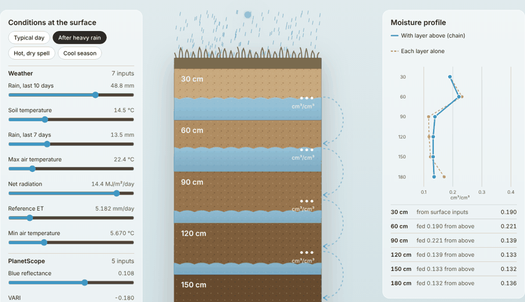
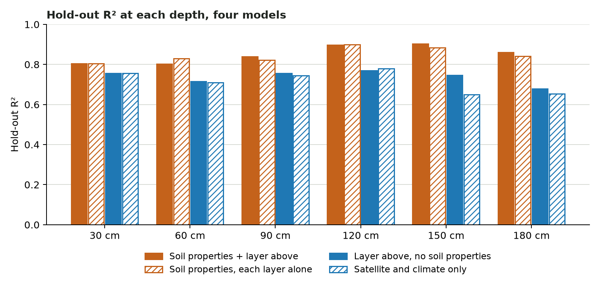
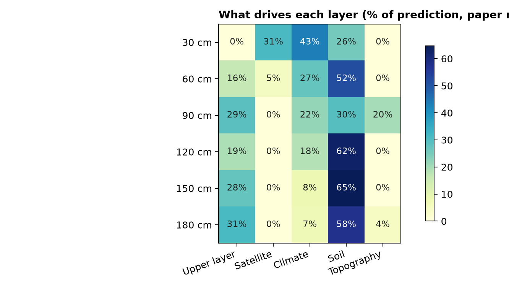

# Multilayer soil moisture, layer by layer: an MLOps pipeline

[](https://github.com/manojlamichhane-ml/multilayer-soil-moisture-mlops/actions/workflows/ci.yml)
[](https://doi.org/10.1002/vzj2.70047)

**Live app:** https://multilayer-soil-moisture-mlops.onrender.com  ·  **API docs:** `/docs` on the same address

This repository turns the research code behind

> Lamichhane, M., Mehan, S., & Mankin, K. R. (2025). Multi-layer root zone soil moisture estimation using field and remote sensing data fusion with machine learning in semi-arid croplands. *Vadose Zone Journal*, 24(6), e70047. https://doi.org/10.1002/vzj2.70047

into a reproducible, tested and deployed machine-learning service. The original analysis notebooks live in a separate repository; this one is about running the method as a system.

<p align="center"></p>

## The method in one paragraph

Satellites see only the top few centimetres of soil. The model predicts volumetric soil moisture at **30, 60, 90, 120, 150 and 180 cm** from PlanetScope reflectance and indices (3 m), daily weather with antecedent rainfall, laboratory soil properties in five layers, and elevation. There is one XGBoost model per depth, each with its own SHAP-selected inputs (5–11). The models are **chained**: the predicted moisture at 30 cm becomes an extra input of the 60 cm model, whose prediction feeds the 90 cm model, and so on to 180 cm.

Four versions are trained and served, so the value of each piece of information can be seen directly:

| | Uses the layer above | Each layer alone |
|---|---|---|
| **With soil properties** | Full chain (the paper's model) | Soil, no chain |
| **Without soil properties** | Chain, no soil | Satellite and climate only |

The "without soil" versions use the paper's 13 satellite, climate and elevation inputs at every depth.

## What this pipeline adds

| | |
|---|---|
| **Settings in one file** | `params.yaml`: inputs for both versions (with and without soil), XGBoost settings, split, chain mode, quality gate |
| **Leak-free chaining** | During training, the "layer above" input is an *out-of-fold* prediction, so each model learns from the same kind of input it will receive in use. `chain_mode: in_sample` reproduces the published setup for comparison |
| **One shared split** | All depths use the same 75/25 split, so no test row is seen by any model in the chain |
| **Four validation tests** | Hold-out, 5-fold CV (chain refit per fold), unseen year (2021), and unseen fields (18 refits) |
| **Pipeline** | DVC: `dvc repro` runs train → evaluate, skipping unchanged stages |
| **Tracking** | MLflow logs every model × depth × test |
| **Quality gate** | The paper's model must reach hold-out R² ≥ 0.60 at every depth |
| **Tests + CI** | 33 pytest checks (leakage, no-soil inputs, chain logic, API, registry) on every push via GitHub Actions |
| **Serving** | FastAPI app with a model picker and an animated soil-profile interface, in a Docker container on Render |

## Results (`strict` mode)

Hold-out R² for the four models:

| Depth | Full chain (paper) | Soil, no chain | Chain, no soil | Satellite and climate only |
|---|---|---|---|---|
| 30 cm | 0.80 | 0.80 | 0.76 | 0.76 |
| 60 cm | 0.80 | 0.83 | 0.72 | 0.71 |
| 90 cm | 0.84 | 0.82 | 0.76 | 0.75 |
| 120 cm | 0.90 | 0.90 | 0.77 | 0.78 |
| 150 cm | 0.90 | 0.88 | 0.75 | 0.65 |
| 180 cm | 0.86 | 0.84 | 0.68 | 0.65 |

The paper's model under harder tests:

| Depth | Cross-validation | Unseen year (2021) | Unseen fields |
|---|---|---|---|
| 30 cm | 0.72 | 0.18 | 0.49 |
| 60 cm | 0.81 | 0.23 | 0.35 |
| 90 cm | 0.80 | 0.27 | 0.27 |
| 120 cm | 0.85 | 0.46 | 0.25 |
| 150 cm | 0.85 | 0.53 | 0.06 |
| 180 cm | 0.87 | 0.64 | −0.08 |

- **Soil properties are worth 0.08 to 0.23 R²** below 30 cm. On unseen fields the gap is far larger: without soil the chain drops below zero from 90 cm down. Without soil data, elevation becomes the main input, standing in for location.
- Feeding the layer above **helps most when soil is missing** (150 cm: 0.75 with the chain against 0.65 without). With soil properties it helps at 90, 150 and 180 cm (R² +0.02) and is neutral at 60 and 120 cm. With leak-free training the gain is smaller than the published 10–27%.
- From 90 cm down, in the paper's model, the **predicted layer above is the single largest driver** of each prediction (19–31%).
- The random hold-out mixes dates and access tubes from the same fields. **Unseen years and fields are much harder**, especially at depth. Treat those columns as the realistic guide for new sites.

<p align="center">
  
  
</p>

## Run it

Python 3.12 is required (XGBoost 3.4).

```bash
conda create -n multilayer_SM python=3.12 -y
conda activate multilayer_SM
pip install -r requirements.txt

dvc repro                     # train + evaluate (~3 min)
dvc metrics show
pytest -v
mlflow ui --backend-store-uri sqlite:///mlflow.db
uvicorn api:app --reload --app-dir src     # http://127.0.0.1:8000
```

The modelling table is private and not in this repository. Place it at `data/model_input.csv`; tests that need it are skipped when it is missing. See [`docs/DEPLOYMENT.md`](docs/DEPLOYMENT.md) to publish your own copy.

## API

```python
import requests
base = "https://multilayer-soil-moisture-mlops.onrender.com"
inputs = requests.get(f"{base}/meta").json()["presets"]["After heavy rain"]["values"]
profile = requests.post(f"{base}/predict", json={"inputs": inputs, "model": "with_soil_chained"}).json()
for layer in profile["layers"]:
    print(layer["depth_cm"], layer["value"], layer["upper_layer_effect"])
print(profile["compare"])          # the same profile from all four models
```

`model` is one of `with_soil_chained` (default), `with_soil_independent`, `no_soil_chained`, `no_soil_independent`. `/predict` returns, for each depth, the prediction, the value fed from the layer above, and how much that feed changed the prediction, plus the profile from every model whose inputs were sent. The no-soil models need only the 13 satellite, climate and elevation inputs. Physically impossible inputs are rejected; values outside the training range return a warning.

## Layout

```
params.yaml, dvc.yaml, dvc.lock    settings, pipeline, fingerprint of the last run
src/config.py                      paths, data loading, shared split
src/chain.py                       the six-depth model chain (fit, out-of-fold feed, predict, save/load)
src/train.py, src/evaluate.py      pipeline stages
src/api.py, src/static/            web app + REST API
models/                            22 XGBoost models in with_soil/ and no_soil/ (+ registry.json)
reports/                           validation tables and figures
tests/                             pytest suite
docs/DEPLOYMENT.md                 step-by-step deployment guide
```

## Citation

```bibtex
@article{lamichhane2025rzsm,
  title   = {Multi-layer root zone soil moisture estimation using field and remote sensing data fusion with machine learning in semi-arid croplands},
  author  = {Lamichhane, Manoj and Mehan, Sushant and Mankin, Kyle R.},
  journal = {Vadose Zone Journal}, volume = {24}, number = {6}, pages = {e70047}, year = {2025},
  doi     = {10.1002/vzj2.70047}
}
```
